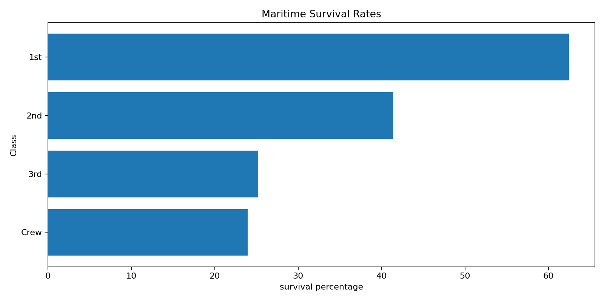

# Maritime Survival Rates — executed results

## Decision question
How does recorded survival proportion differ by passenger class and crew?

## Evidence
The largest observed survival percentage is 62.462 for 1st. This ranking is descriptive, not a recommendation.

Raw rows: 32. Rows used: 32. Excluded for missing/nonfinite required values or invalid denominator: 0.

## Method
Frequency-weighted survival percentage = 100 × surviving people / all recorded people, grouped by class.

## Interpretation and limitations
Aggregated historical counts; passenger composition and access differ across groups. No causal inference, significance claim or production deployment is implied. Missing values are not imputed; identical rows are retained. Small or repeated samples limit uncertainty interpretation.

## Recommended next decision
Compare age- and sex-stratified survival rates before attributing causes.

## Reproducibility
Source and exact downloaded-byte SHA256 are recorded in run_manifest.json. SQL results are in answer.csv and analysis.sqlite. Review quality_audit.csv before interpretation.
